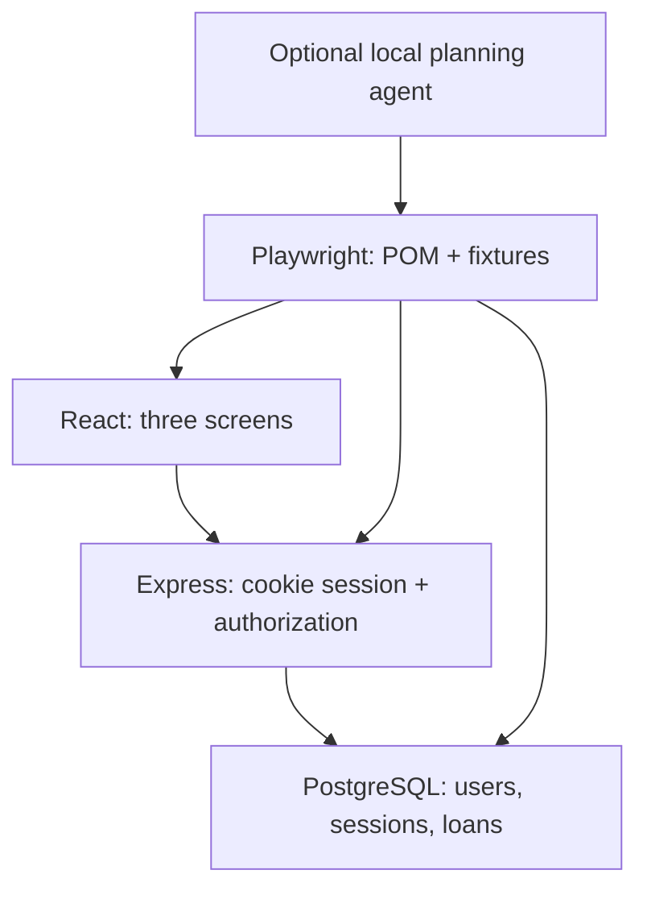
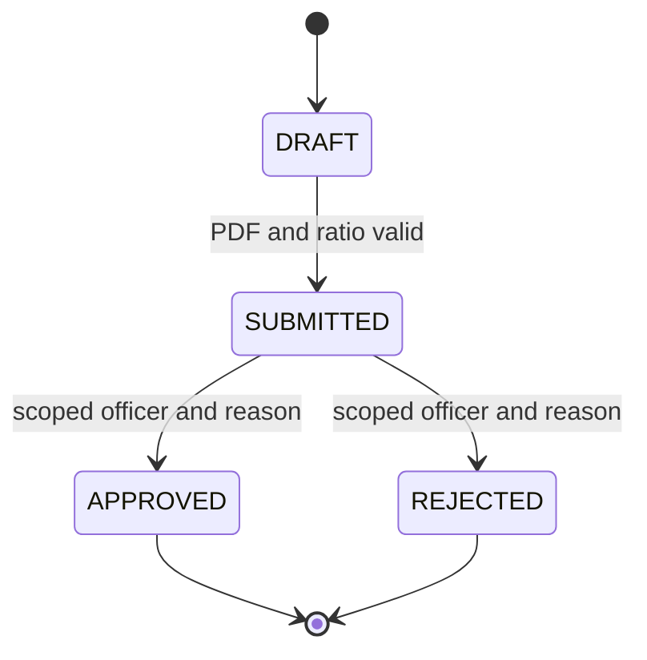

# Architecture and key decisions

A single TypeScript repository deliberately keeps the app small while separating server/, client/, shared/ and tests/. Vite proxies /api to Express; browser cookies therefore remain same-origin. PostgreSQL stores uploaded synthetic PDF bytes as BYTEA so there is no upload-directory path traversal or external storage dependency. No real files should be uploaded. Upload checks MIME, extension and PDF signature only; it does not fully parse PDF contents. The automated presence checks use a minimal synthetic signature fixture, while a valid one-page PDF is included for manual demos.

## Important functions

- `inputSchema`: validates names, purpose and positive two-decimal amounts. `loanSchema` validates the complete API response.
- `toLoan`: converts database snake_case and NUMERIC strings to the public TypeScript JSON contract. It never includes document bytes or password hashes.
- Authentication middleware: resolves a random, four-hour HttpOnly session cookie to a seeded account. The selected frontend role cannot grant backend authority.
- Loan-ID middleware: loads the record and checks owner/scope before read or mutation. Applicants cannot read another user's record; officers cannot access another scope.
- Submit handler: checks required PDF and DRAFT state, then compares exact NUMERIC values in PostgreSQL against 0.8 × property value. This avoids binary floating-point boundary rounding.
- Review handler: requires officer, valid reason, and SUBMITTED state. A conditional UPDATE changes status atomically. A concurrent loser receives 409; the status and reason are persisted together.
- `record`/`persisted`: parameterized SELECT and reusable comparisons for status, owner, reason, document and loan amount. Denied operations compare the complete selected row before/after.
- `fixtures.ts`: provides API/page objects, QA-data cleanup and worker-level pool teardown. API calls and browser contexts do not share auth unless intentionally using page.request in a cross-layer test.
- `evaluate.ts`: fresh seed and API/Vite for every clean/fault × approach cell, fixed assertions, JSON aggregation and a known-fault/probe mapping separated from tests.

## State machine

DRAFT may be created with an over-limit ratio so that submission validation can be demonstrated. Finalized records have no public mutation endpoint. Document replacement is limited to DRAFT. All SQL uses parameter values; never interpolate request data into SQL.

## Demo security boundaries

Passwords use scrypt with demo account-derived salts; session tokens use cryptographic randomness and database expiry. HttpOnly/SameSite=Strict cookies, size limits and role/scope enforcement are present. This is not production authentication: there is no password lifecycle, rate limiting, identity provider, session housekeeping job, security audit or document malware scanner. Keep it on localhost.

## Portable verification

scripts/portable.ts provides an explicit PostgreSQL WASM (PGlite) fallback over the PostgreSQL wire protocol. The application and SQL helpers still use node-postgres. Its query multiplexer serializes work; therefore its concurrent-decision result does not certify real PostgreSQL multi-session locking. Docker Compose/native PostgreSQL is the primary deployment and CI target; the fallback is labeled wherever results are reported.
