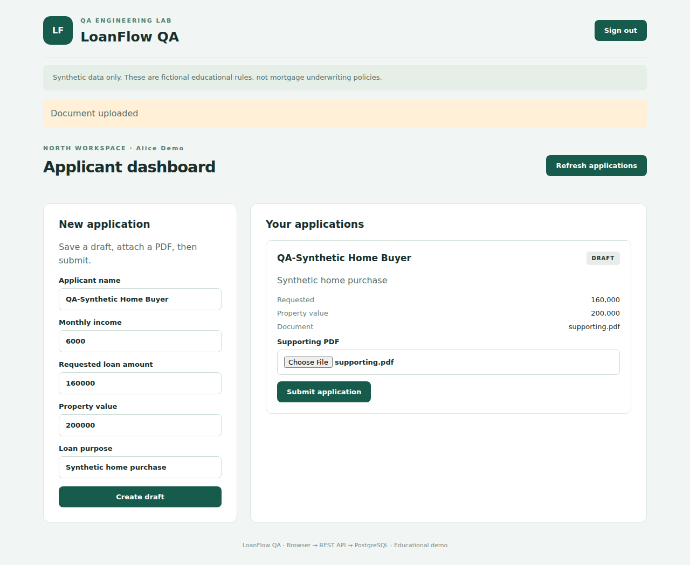
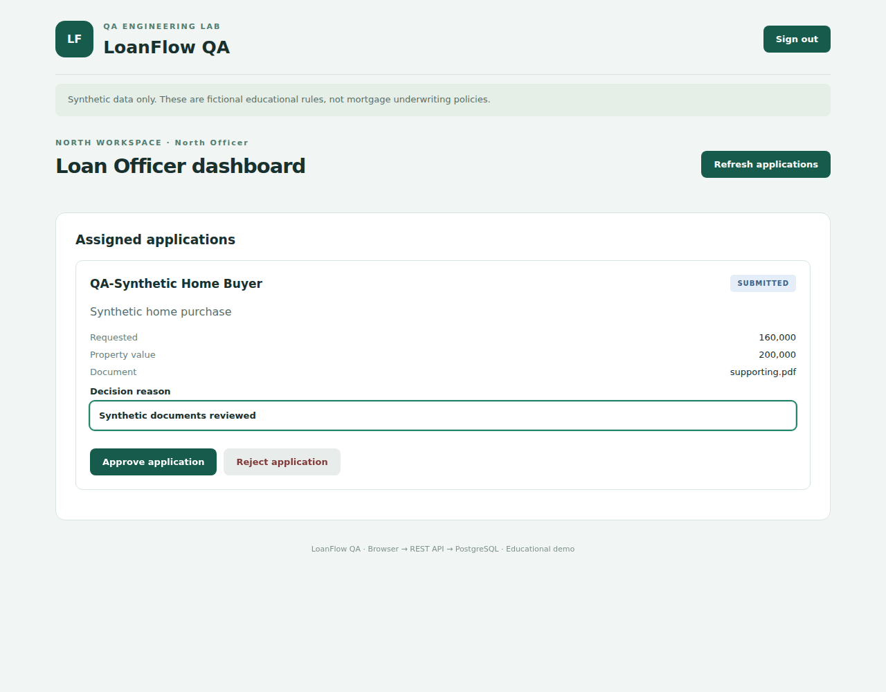
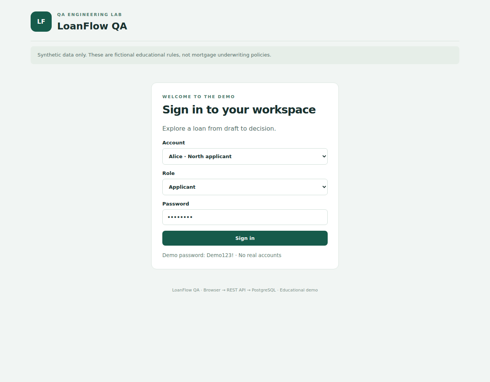
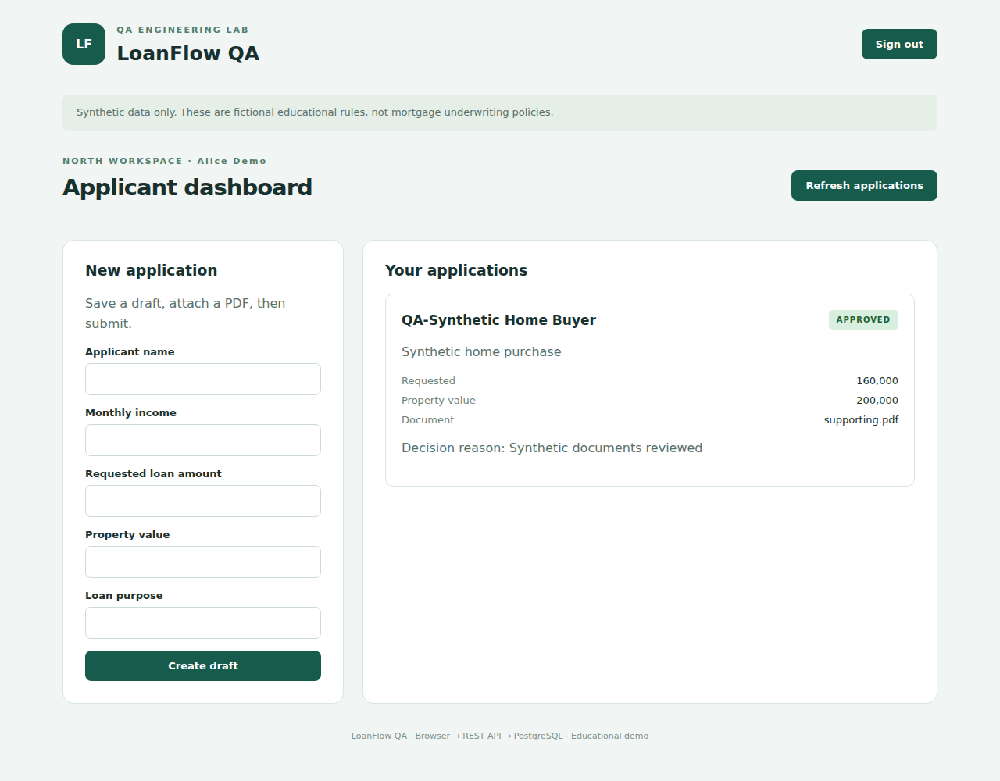
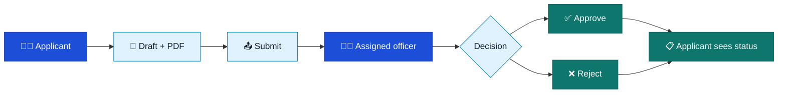
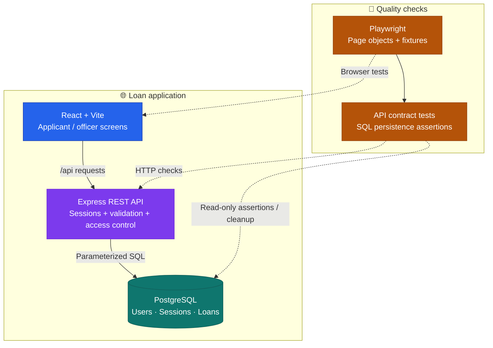
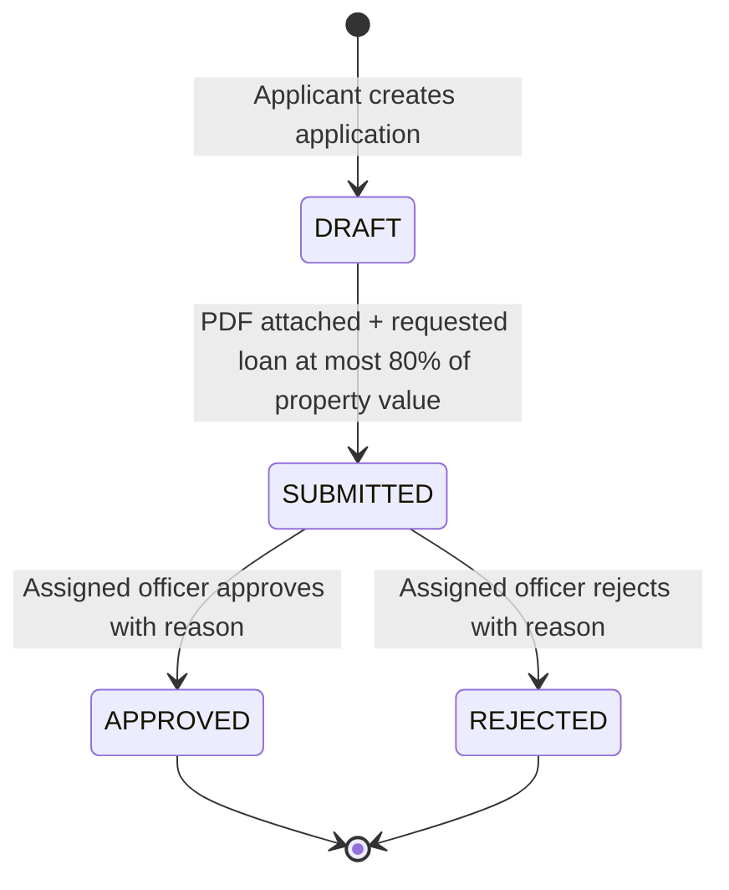
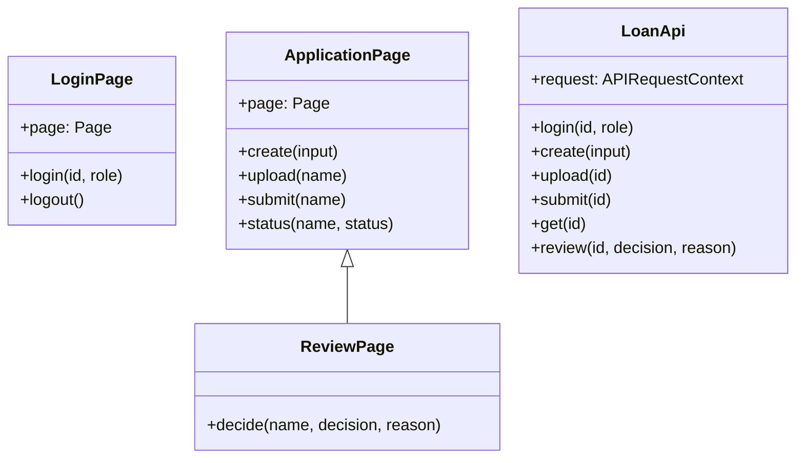
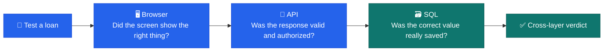

# 🏦 LoanFlow QA

**A small mortgage application with a serious testing habit.**

<p>
  
  
  
  
  
  
</p>

**[✨ What it does](#-what-is-loanflow-qa)** · **[🖼️ Screenshots](#-take-a-look)** · **[🏗️ Architecture](#-how-the-system-fits-together)** · **[🚀 Set it up](#-run-it-on-your-computer)** · **[🧪 Run tests](#-testing-the-whole-journey)** · **[📚 More diagrams](docs/DIAGRAMS.md)**

> **In one sentence:** LoanFlow QA checks whether a mortgage application works not only *on the screen*, but also in the API and the database—where some of the most serious mistakes can hide.

> [!NOTE]
> This is a **local, educational QA portfolio project** with fictional accounts and synthetic loan information. It is **not** a bank product, credit-decision system, customer-data service, or production deployment.

## 💡 What is LoanFlow QA?

Imagine that you apply for a home loan online. You fill in the form, attach a PDF, and see “Application submitted.” Later, a loan officer approves it. Everything *looks* fine—but what if the approval was never saved? Or if an officer could view a loan belonging to another region?

That is the problem this project explores.

LoanFlow QA has **two parts**:

1. **A miniature mortgage application** where applicants create and submit applications, while loan officers review them.
2. **An automated quality-assurance framework** that checks the same journey at three levels: the browser, the REST API, and the SQL database.

I also introduced eight deliberately reversible defects and compared what two testing approaches could detect. This makes the project an experiment in *how* to test, not merely whether a test script runs.

### 📊 Results at a glance

| What I measured | Recorded result | What it means |
|---|---:|---|
| Clean Chromium test suite | **30/30 passed** | Browser, API, permissions and persistence checks passed in the evaluated environment |
| Deliberately injected defects | **8** | Eight known, reversible problems were tested |
| UI-only detection | **5/8 (62.5%)** | Looking at browser behavior alone missed three faults |
| Browser + API + SQL detection | **8/8 (100%)** | The expanded suite caught all eight *selected* faults |
| Experiment cells | **18** | One clean baseline and eight faults, tested with each approach |

**Fair comparison note:** The expanded suite also contains more test cases (30 vs. 11). These results describe **this synthetic fault set**, not universal QA accuracy. The recorded tests ran with a **PostgreSQL-compatible PGlite/WASM fallback**, not a verified native-PostgreSQL production installation. See [full evaluation and limitations](EVALUATION.md).

## 🖼️ Take a look

These are screenshots from the local synthetic demonstration—not a public hosted app.

| Applicant journey | Loan officer review |
|:---:|:---:|
|  |  |
| **Create and submit** | **Review and decide** |
|  |  |
| **Sign in with a demo account** | **See the final status** |

## 👥 Who uses it?

| Person | What they can do | What they cannot do |
|---|---|---|
| 🧑‍💼 **Applicant** | Create a draft, attach a PDF, submit a loan, check its status | Read another applicant's loan or make an officer's decision |
| 🧑‍⚖️ **Loan officer** | View applications in their assigned scope; approve/reject a submitted loan with a reason | Access an unrelated scope or make the same final decision twice |
| 🧪 **QA tester** | Exercise browser workflows, APIs and database records; run controlled defect experiments | Treat demo findings as production or regulatory certification |



## 🏗️ How the system fits together

The web app and the testing framework live in the same repository, but they have different jobs. The application runs the loan process; Playwright checks whether it behaves correctly.



**In plain English:** React displays forms. Express checks who is signed in and whether their action is allowed. PostgreSQL stores the real state. Playwright behaves like a user *and* independently inspects the HTTP response and stored record.

### 🧭 What happens to a loan?



The **80% limit is a fictional business rule for this exercise**. It is not financial advice or a claim about real lending regulations. A second final review is refused with HTTP **409 Conflict**. The server enforces permissions even if someone skips the user interface.

### 🧩 Class diagram: how the tests are organized

This codebase does **not** use a Java-style class hierarchy for loans and users. Its actual classes are reusable **test helpers**, so the class diagram shows those rather than imaginary domain objects.



[More diagrams: database relationships, request sequence and QA workflow →](docs/DIAGRAMS.md)

## 🚀 Run it on your computer

The intended primary setup uses **Node.js 24**, **npm**, **Docker Desktop with Linux containers**, and **Playwright Chromium**. These are instructions for a local demo; Windows/Docker execution was not independently confirmed in the original evaluation environment.

### 1. Install the prerequisites

- [Node.js 24](https://nodejs.org/) with npm
- [Docker Desktop](https://www.docker.com/products/docker-desktop/) — start it before running the database
- [Git](https://git-scm.com/) (only needed to clone the repository)
- Free ports: **5432** (PostgreSQL), **3001** (API), and **5173** (web app)

### 2. Download the code

Clone the repository after it is published:

```powershell
git clone https://github.com/yusufthecoder474/LoanFlow-QA.git
cd LoanFlow-QA
```

Or download **Code → Download ZIP**, extract it, and open PowerShell inside the project directory.

### 3. Create your local environment file

```powershell
Copy-Item .env.example .env
npm ci
```

The example is for a localhost demo only. **Never upload `.env` to GitHub or use these demo passwords on an internet-facing service.**

### 4. Start PostgreSQL and load synthetic accounts

```powershell
docker compose up -d --wait
npm run db:migrate
npm run db:seed
```

> [!CAUTION]
> `db:seed` **resets users, sessions and loans** in the database configured by `DATABASE_URL`. Use only the dedicated synthetic `loanflow` database; never point it at customer or personal data.

### 5. Start the app

```powershell
npm run dev
```

Open **http://127.0.0.1:5173**. The API listens locally on port 3001, and Vite forwards `/api` requests to it.

### 6. Sign in with a demo account

| Account | Select role | Region / scope |
|---|---|---|
| `alice` | Applicant | North |
| `bob` | Applicant | South |
| `officer-north` | Loan Officer | North |
| `officer-south` | Loan Officer | South |

All four synthetic accounts use the **local-demo password `Demo123!`**. They are deliberately not real accounts. For manual document upload, use the included [sample PDF](artifacts/demo/supporting.pdf)—not personal financial documents.

### 7. Try a complete journey

1. Log in as `alice` and create a draft application.
2. Upload the synthetic supporting PDF and submit the draft.
3. Sign out; log in as `officer-north` and record an approval or rejection with a reason.
4. Log in as `alice` again and check the final status.
5. Try using `officer-south` on a North-scope loan to see authorization enforcement.

## 🧪 Testing the whole journey

Stop the manual `npm run dev` session with **Ctrl+C** first so Playwright can manage its own local servers. Leave the Docker PostgreSQL container running.

```powershell
npx playwright install chromium
npm run typecheck
npm run lint
npm run build
npm test
npm run report
```

The normal test command runs the Chromium suite. Playwright creates its API and web servers from the configuration, and produces reports. To run only the smoke scenarios:

```powershell
npm run test:smoke
```

To repeat the controlled eight-fault comparison:

```powershell
npm run evaluate
```

The evaluation **resets synthetic test data repeatedly** and includes intentional failing cases. Do not run it against a real database or while manually hosting the app.

### What makes the QA approach different?



A particularly useful example is an **approval response that says “APPROVED” even though the database still says “SUBMITTED.”** A basic screen check might miss it, but the SQL persistence check exposes the contradiction.

| Command | Use it for |
|---|---|
| `npm run dev` | Run the local React + API app |
| `npm run db:migrate` | Create the database tables |
| `npm run db:seed` | Reset the *synthetic* data and demo accounts |
| `npm test` | Run the clean Chromium suite |
| `npm run test:ui-only` | Run UI-only scenarios |
| `npm run test:firefox` | Optional Firefox smoke checks; environment support varies |
| `npm run evaluate` | Run the controlled 18-cell comparison |
| `npm run report` | View the Playwright HTML report |

### 🧳 No Docker available?

There is an explicitly labeled fallback using **PGlite (PostgreSQL compiled to WebAssembly)**:

```powershell
npx playwright install chromium
npm run verify:portable
```

This is the environment used for the recorded clean Chromium result. It helps verify application behavior, **but does not prove native PostgreSQL locking, Docker deployment or production performance**.

## 🛡️ Security decisions and limitations

A testing project should demonstrate that the server, not the interface, makes the important decisions:

- **Session handling:** randomized, HttpOnly, SameSite=Strict cookies with expiry.
- **Access control:** applicants see their own loans; officers see assigned scopes.
- **Input validation:** strict Zod contracts; a required decision reason; parameterized SQL queries.
- **Data integrity:** a conditional database update prevents two clean review requests from both finalizing the same loan.
- **Documents:** demo PDFs are limited to 2 MB and checked for filename, MIME type and a PDF header—not scanned for malware or deeply parsed.

**Not production ready:** This sample does not include enterprise identity, rate limiting, document malware scanning, operational security review, real-world lending integrations, or a deployed environment. It uses synthetic test credentials only.

## 🗂️ Where to find things

```text
LoanFlow-QA/
├── client/                 React screens and styles
├── server/                 Express API, sessions and SQL access
├── shared/                 Zod schemas / TypeScript contracts
├── db/migrations/          PostgreSQL schema
├── tests/                  Playwright UI + cross-layer tests
│   ├── pages/              LoginPage, ApplicationPage, ReviewPage
│   ├── helpers/            API, database and assertion helpers
│   └── fixtures.ts         Shared test setup / isolation
├── scripts/                Database setup, demo, experiments, PGlite
├── artifacts/demo/         Synthetic screenshots and sample PDF
├── .github/workflows/      CI checks and separate experiment workflow
├── docs/                   Visual diagrams and troubleshooting
├── EVALUATION.md           Exact outcomes, method, limitations
├── TEST_PLAN.md            Test strategy
├── TEST_CASES.md           Coverage and expected behavior
├── BUG_REPORTS.md          Reproduction of deliberate defects
├── ARCHITECTURE.md         Detailed design choices
├── README.md               You are here
└── LICENSE                 Source-code license
```

## 🔧 Troubleshooting

| Problem | First thing to check |
|---|---|
| Docker isn't ready | Open Docker Desktop, then run `docker compose ps` |
| Database connection fails | Check port 5432 and whether `.env` matches the Docker credentials |
| API or frontend port is taken | Stop older `npm run dev` / Playwright processes on ports 3001 or 5173 |
| Browser executable missing | Run `npx playwright install chromium` |
| A test unexpectedly fails | Reseed the *synthetic* database and inspect `npm run report` |
| Firefox crashes in a restricted sandbox | Use the Chromium suite; see [documented Firefox limitation](EVALUATION.md) |

For copy-paste diagnostics and a safe cleanup guide, read [Setup & Troubleshooting](docs/SETUP_AND_TROUBLESHOOTING.md).

To stop the demonstration database without deleting the named database volume:

```powershell
docker compose down
```

## 🔄 CI, documentation and project boundaries

A [GitHub Actions workflow](.github/workflows/ci.yml) is provided for dependency installation, PostgreSQL service setup, migrations, TypeScript checks, lint, build and browser tests. **A successful hosted CI run has not been independently established in the original supplied evidence.** The [experiment workflow](.github/workflows/experiment.yml) is separate, so intentionally broken cases do not become part of ordinary clean checks.

Some files you may want to explore next:

- 📋 [Requirements](REQUIREMENTS.md) and [Test plan](TEST_PLAN.md)
- 🗺️ [Visual diagrams](docs/DIAGRAMS.md) and [Architecture details](ARCHITECTURE.md)
- 📈 [Measured evaluation](EVALUATION.md) and [evaluation table](artifacts/evaluation-table.md)
- 🐞 [Seeded bug reports](BUG_REPORTS.md)
- 🤖 [Optional AI-agent workflow](AI_AGENT_WORKFLOW.md): agents are **optional**; no AI key is needed to run normal tests

## 🙋 Why I built it

I wanted a QA project that would be understandable even to someone who has never written a test. A loan is a familiar enough process, but it also has interesting failure cases: privacy, access rules, stale decisions, and answers that look right until you query the database. LoanFlow QA lets me demonstrate those problems with code, repeatable tests and actual evidence—not only screenshots of a green test report.

## 📄 License

The original repository declares **ISC** in `package.json`. See [LICENSE](LICENSE) for the matching source-code license. Third-party dependencies retain their own licenses. This project is for learning and demonstration; its license does not make it a regulated lending product.
