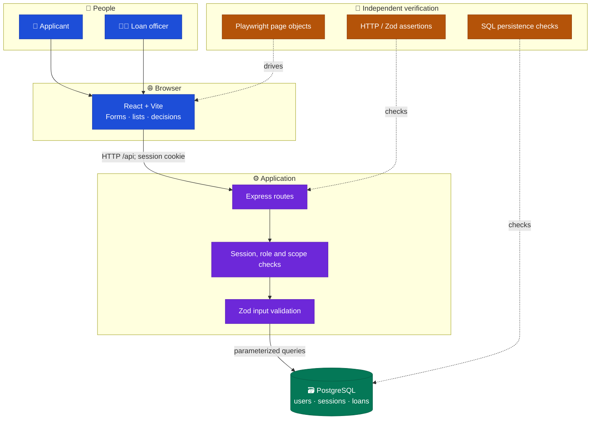
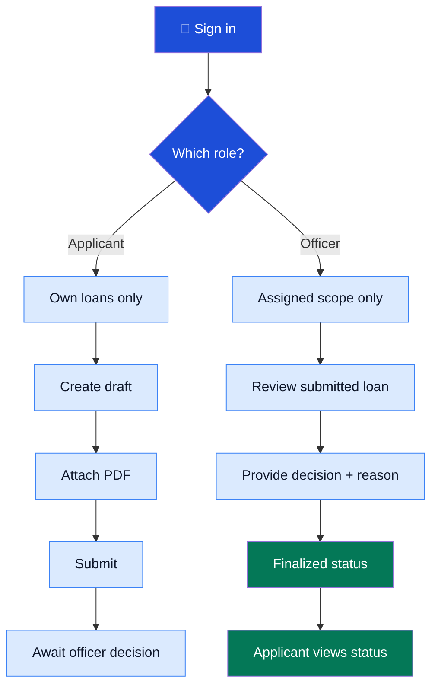
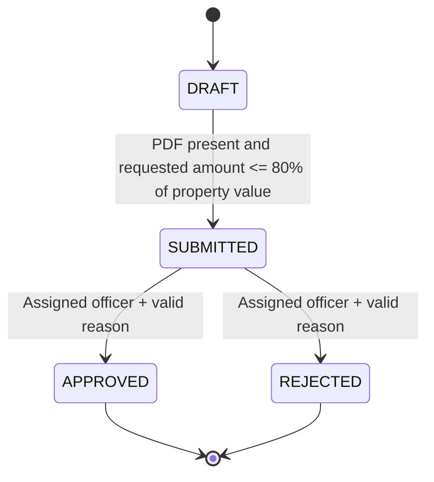
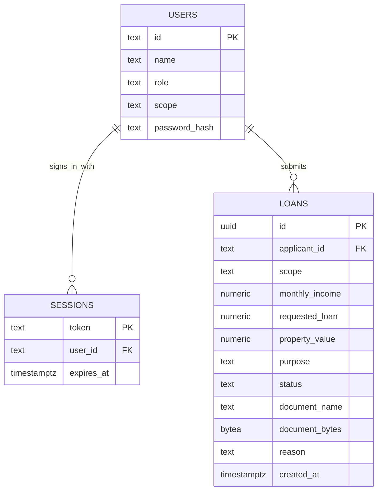
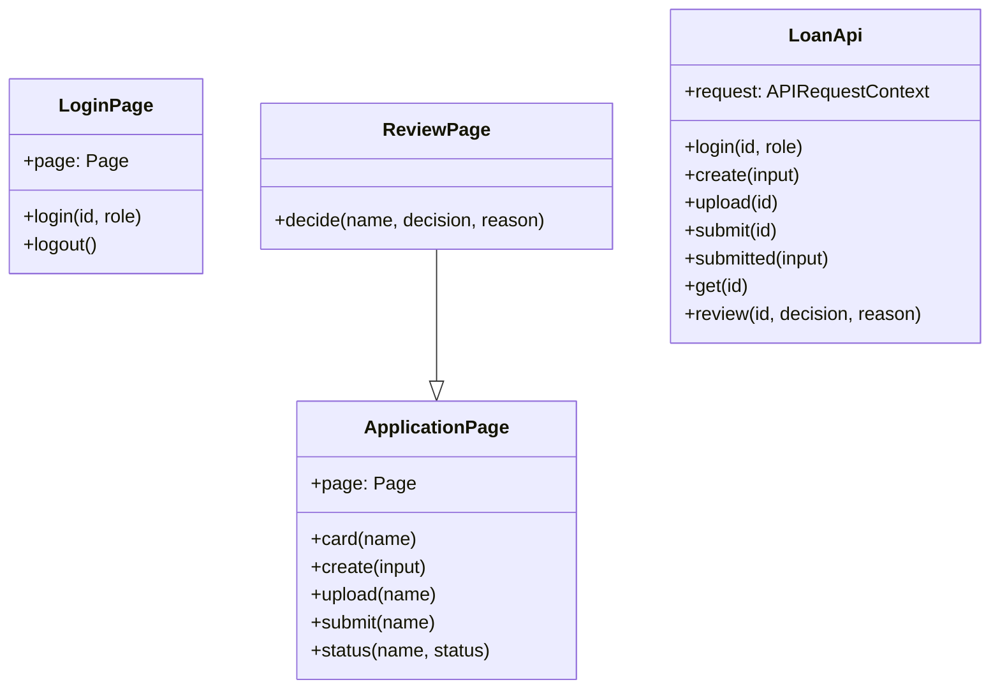
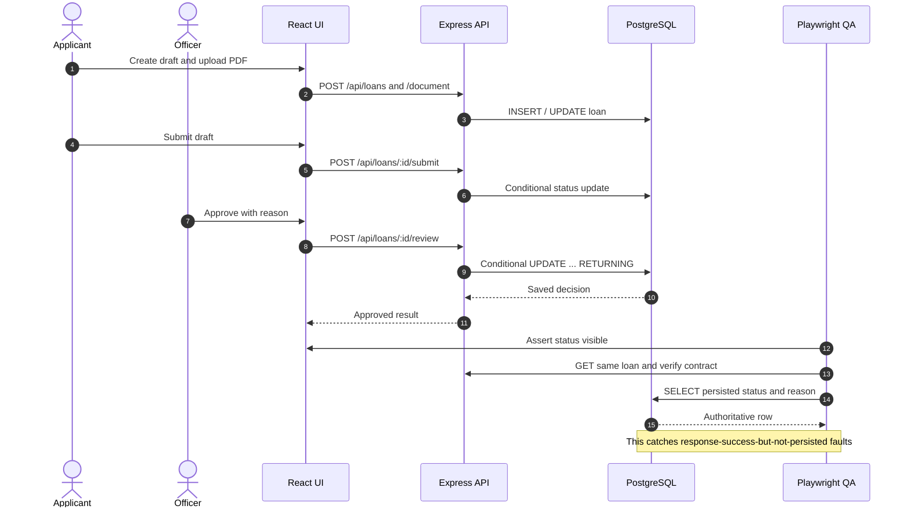
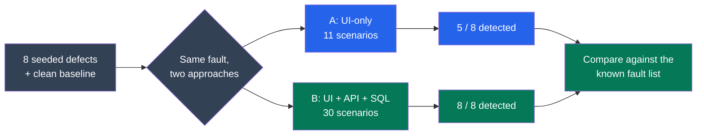

# 🗺️ LoanFlow QA — Architecture & Visual Diagrams

[← Back to README](../README.md) · [Setup guide](SETUP_AND_TROUBLESHOOTING.md)

These diagrams are designed for GitHub's built-in **Mermaid** renderer, so they stay editable alongside the code. Colored blocks help distinguish users, application code, stored data and automated tests. The diagrams describe the local demonstration, **not** a live banking system.

## 1. 🔎 System architecture



**Explanation:** The UI is the visible part, but it does not decide permissions. The server checks accounts and scopes; the database holds the authoritative status. Playwright examines all three layers.

## 2. 👥 User actions and permission boundaries



**Privacy rule:** An applicant cannot read someone else's loan; a loan officer cannot access another scope. These are enforced in the API, not just hidden buttons.

## 3. 🔄 Application state machine



**Protection:** A finalized loan cannot be reviewed a second time in the clean implementation. Competing reviews use a conditional SQL update; one winner gets the decision, the other gets a conflict.

## 4. 🗃️ Actual database relationships (ERD)



Only **three tables** are created by `db/migrations/001_initial.sql`. `LOANS.scope` is used to decide which officer may see/review an application; it is not a separate officer foreign key. A loan stores the *document bytes* in PostgreSQL in this small local demo.

## 5. 🧩 Actual QA classes



The classes above are real TypeScript test helpers in `tests/pages/` and `tests/helpers/api.ts`. User, Loan and Session are database rows / TypeScript contracts, **not** OO domain classes; inventing classes for them would misrepresent the implementation.

## 6. 📨 One approval, inspected three ways (sequence)



## 7. 🧪 Experiment: what each approach checks



**Limitations:** The 30-scenario version checks more cases *as well as* more layers. Tests were conducted on PGlite with one fixed ordering and one trial per experiment cell. Do not extrapolate these numbers to production defect-detection rates. For full methodology, see [EVALUATION.md](../EVALUATION.md).

## 8. ⚙️ CI configuration (planned verification path)

```mermaid
flowchart LR
  G["Git push / pull request"] --> CI["GitHub Actions workflow"]
  CI --> PG["PostgreSQL service"]
  PG --> DEP["npm ci + migrate + seed"]
  DEP --> CHECK["Types + lint + build"]
  CHECK --> CH["Chromium tests"]
  CH --> FF["Firefox smoke"]
  FF --> ART["Upload reports / evidence"]
  classDef start fill:#2563eb,color:#fff
  classDef job fill:#6d28d9,color:#fff
  classDef end fill:#047857,color:#fff
  class G start
  class CI,PG,DEP,CHECK,CH,FF job
  class ART end
```

The workflow is **configured**, not claimed as having passed on hosted GitHub runners. `experiment.yml` is manual and separate because deliberate defect injections must not be confused with normal green CI.
